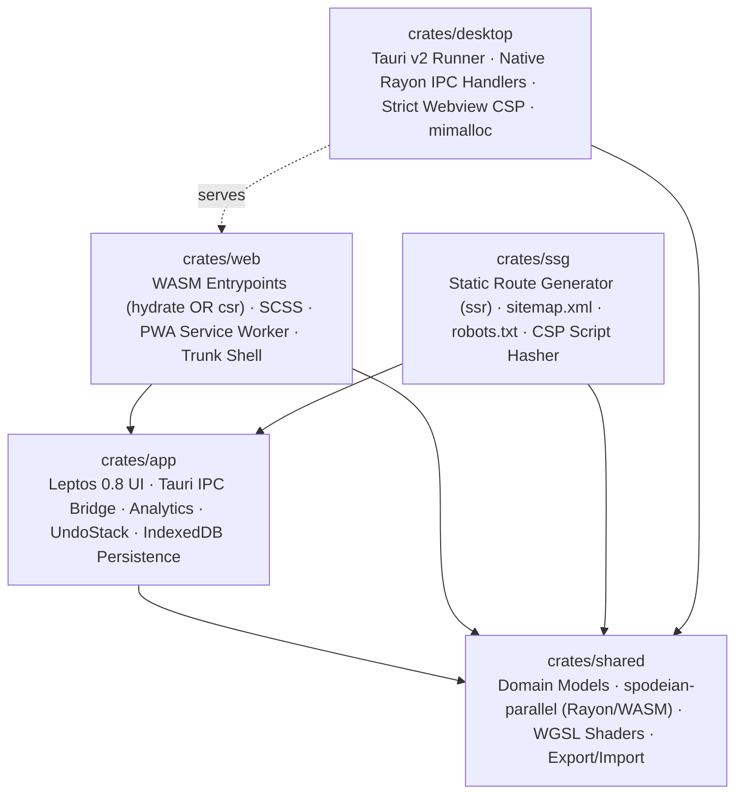

# Architecture Guide · `efficient-leptos-template`

This template builds **two complementary targets from one Leptos 0.8 codebase**:
1. **Serverless Edge Web Release (`ssr` + `hydrate`)**: Pre-rendered static HTML + WASM hydration deployed to Cloudflare Pages, GitHub Pages, Netlify, or S3.
2. **Native Desktop & Mobile Bundle (`csr` + `Tauri v2`)**: Local OS executable and mobile shell (`crates/desktop`) communicating with frontend components through typed Tauri IPC commands.

---

## 1. Five-Crate Dual-Target Topology

| Crate | Features | Responsibility |
|---|---|---|
| `crates/shared` | `std` | Portable domain models (`Item`, `ItemCollection`, `AppState`, `UndoStack`), `ComputeRuntimeSummary`, `spodeian-parallel` sweeps, WGSL compute kernel (`PARAMETRIC_HARMONIC_WGSL_SHADER`), and JSON/CSV/BSON/SVG/HTML/`#state=` interchange. |
| `crates/app` | `ssr`, `hydrate`, `csr` *(mutually exclusive)* | Reactive Leptos views, Tauri IPC bridge (`tauri_bridge`), searchable `CommandPaletteModal`, `AnalyticsPage`, and `spodeian-cache` persistence. |
| `crates/web` | `hydrate` OR `csr` | Compiles to `hydrate()` when bundled by `cargo-leptos` for edge web hosting, or `start()` (CSR) when bundled by Trunk inside Tauri desktop/mobile builds. |
| `crates/ssg` | `ssr` | Generates deterministic HTML for `/`, `/analytics`, `/about`, and `/404`, strips nonces, emits `sitemap.xml` & `robots.txt`, stamps `sw.js`, and computes SHA-256 CSP inline-script hashes. |
| `crates/desktop` | `tauri` | Native Tauri v2 host registering native Rayon-backed IPC commands (`desktop_runtime_summary`, `compute_harmonic_sweep_native`) and enforcing webview CSP. |

---

## 2. Why Feature Mutually-Exclusive Modes (`ssr` / `hydrate` / `csr`)

Never pass `--all-features` to this workspace:
- **Static SSR Build (`cargo clippy -p shared -p app -p ssg --features app/ssr`)**: Renders all routes at build time into zero-JS crawlable HTML.
- **Web Hydration Build (`--features app/hydrate,web/hydrate`)**: Attaches client reactivity directly onto pre-rendered DOM nodes (`client_ready()` ensures post-mount state hydration never causes SSR/client mismatches).
- **Desktop Tauri CSR Build (`--features app/csr,web/csr`)**: Trunk compiles a client-side bundle loaded offline from Tauri's embedded `frontendDist`.

---

## 3. Tauri v2 IPC & Parallel Compute (`rayon` + `wasm32` + `wgpu`)

- **Shared `spodeian-parallel` Sweeps**: `ParametricPreviewConfig::sample_points` and `batch_harmonic_sweep` execute across OS worker threads via **Rayon** inside `crates/ssg` and `crates/desktop` (`compute_harmonic_sweep_native`), and compile transparently to sequential SIMD128 loops on `wasm32`.
- **Safe Webview IPC (`crates/app/src/tauri_bridge.rs`)**: `is_tauri_desktop()` detects `window.__TAURI_INTERNALS__`, allowing frontend components to call `invoke_tauri_command("desktop_runtime_summary", "{}")` on desktop while staying purely in-browser on web deployments.
- **WebGPU Compute Ready (`PARAMETRIC_HARMONIC_WGSL_SHADER`)**: Pair the bundled WGSL harmonic compute shader with `sml_kernel::WgpuContext::new_async` for GPU dispatch when `navigator.gpu` or Vulkan/Metal/DX12 is available.

---

## 4. Storage, CSP & Offline PWA

- **Pre-paint Consistency**: `shell.rs` and `crates/web/index.html` share identical `THEME_PREPAINT_SCRIPT` logic restoring both theme and dyslexia preferences before first paint (`app_tests` asserts parity continuously).
- **Working-Set Bounded Persistence**: `AsyncTieredStore` holds the active working set in RAM (`MEMORY_WORKING_SET_LIMIT = 100`) and spills overflow records to IndexedDB / disk backing.
