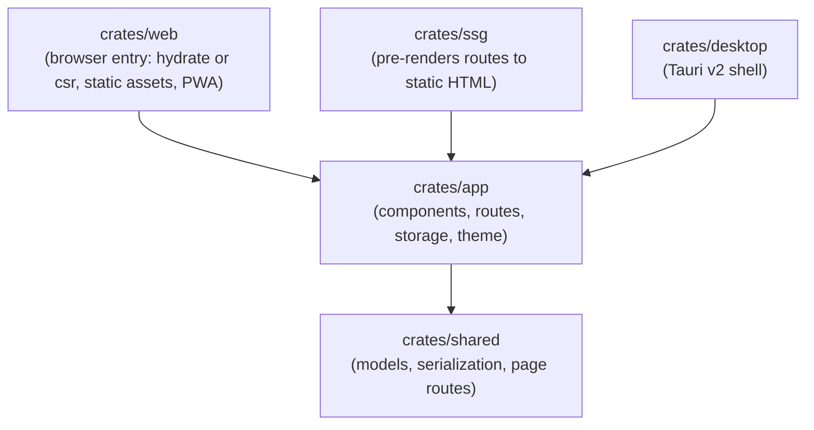

# Serverless & Desktop Leptos Template

[](https://github.com/Spodeian/efficient-leptos-template/actions/workflows/ci.yml)
[](https://github.com/Spodeian/efficient-leptos-template/actions/workflows/static.yml)
[](LICENSE.md)
[](https://www.rust-lang.org)
[](https://leptos.dev)
[](https://v2.tauri.app)
[](https://pages.cloudflare.com)

A modular Rust & [Leptos 0.8](https://leptos.dev) template with two release targets from one codebase:

- **Web**: pre-rendered static HTML that hydrates in the browser (SSR + hydration, no server). Pages carry their content without JavaScript, then become interactive. Deploys to any static host (Cloudflare Pages, GitHub Pages).
- **Desktop**: a client-side-rendered (CSR) bundle built with Trunk and loaded by Tauri v2 (Windows, macOS, Linux).

The example app has a top bar, routed Dashboard and About pages, interactive item management, offline support (PWA) and persistent storage built on the `spodeian-*` libraries.

---

## 🚀 Using this Template

### Option A: `cargo-generate` (Recommended)
```bash
cargo install cargo-generate
cargo generate --git https://github.com/Spodeian/efficient-leptos-template.git
```
Interactive prompts in [`cargo-generate.toml`](cargo-generate.toml) let you keep or exclude `crates/desktop` (Tauri v2), offline PWA assets (`sw.js`, `manifest.json`), and Cloudflare Pages configuration (`wrangler.toml`, `_headers`, `deploy.sh`).

### Option B: GitHub Template
1. Click **"Use this template"** > **"Create a new repository"** on GitHub.
2. Clone your new repository and follow [Customizing for Your App](#-customizing-for-your-app).

---

## 🏛️ Architecture



- **`crates/shared`**: domain models (`AppConfig`, `AppPage`, `AppState`) and JSON/CSV/BSON import and export.
- **`crates/app`**: the Leptos UI and routes (`/`, `/about`, 404), with a `PageMeta` title and description per page. Exactly one rendering feature is enabled per build: `ssr`, `hydrate` or `csr` (there is no default).
- **`crates/web`**: the wasm entry point (`hydrate()` or `start()`), `public/` assets (service worker, manifest, icons, self-hosted fonts, `_headers`) and the desktop Trunk `index.html`.
- **`crates/ssg`**: a native binary that generates every static route to HTML, then finalises the site: it fills the service-worker precache list and build ID, and the CSP script hashes in `_headers`.
- **`crates/desktop`**: the Tauri v2 runner.

### Rendering modes

| Target | Mode | Built with | Output |
|---|---|---|---|
| Web release | SSR (static) + hydration | `scripts/build-web.sh` (cargo-leptos + `ssg`) | `target/site` |
| Desktop | CSR | Trunk (`Trunk.toml`) via Tauri | `crates/web/dist` |

Hydration safety rule: the first client render must match the server HTML. Defaults render first; saved theme and state load afterwards in an effect (`client_ready()` in `crates/app/src/client.rs`).

---

## ✨ Key Features

- **Static SSR + hydration** with content-hashed `/pkg/` bundles and byte-reproducible HTML.
- **Persistence on `spodeian-cache`**: preferences and blobs go through `PreferentialStore` (localStorage, IndexedDB or Cache API chosen per value); items go through a write-through `AsyncTieredStore` with a bounded in-memory working set. Failed saves are surfaced to the user rather than swallowed. State saved by 0.1.x is migrated automatically on first load.
- **Telemetry viewer** showing real `spodeian-telemetry` metrics and log entries, with export and clipboard confirmation only on success.
- **Offline PWA**: network-first navigations, cache-first hashed assets, and a precache list generated at build time. The cache is versioned per build.
- **Strict CSP**: no external hosts, no `unsafe-eval`. Inline scripts are allowed by hash, generated at build time. Fonts (Atkinson Hyperlegible) are self-hosted.
- **Accessibility**: skip link, `aria-current` navigation, modal focus trapping via `spodeian-leptos-ui`, dyslexia-friendly font option, recoverable `<ErrorBoundary>` alert view, and WCAG AA contrast for text colours enforced by automated tests.
- **Themes**: Dark, Warm Light, High Contrast Dark, and High Contrast Light applied before first paint via `spodeian-tokens` and `spodeian-leptos-ui`.

### Comparison vs. Official Leptos Starters

| Capability | `efficient-leptos-template` | Official `start-axum` | Official `start-trunk` |
|---|---|---|---|
| **Targets** | Static SSR + Hydration **and** Tauri v2 Desktop CSR | Axum SSR Server + Hydration | Client-Side CSR only |
| **Hosting** | Zero-backend static hosts (`crates/ssg` + `_headers`) & Desktop | Requires Rust server runtime | Static CSR only (empty shell HTML) |
| **Persistence** | `spodeian-cache` + `spodeian-persist` (IndexedDB, LocalStorage, Cache API, CAS) with `schema_version` migration | None built in | None built in |
| **Interchange** | Built-in JSON, RFC 4180 CSV, and Zlib-compressed BSON (`spodeian-export`) | None built in | None built in |
| **Security & PWA** | Build-time `sw.js` precache & SHA-256 CSP inline-script hashing (`spodeian-web-utils::pwa`) | None built in | Manual config |
| **A11y & Resilience** | Modal Tab trap (`spodeian-leptos-ui`), dyslexia toggle, `<ErrorBoundary>` recovery, WCAG AA contrast tests | Minimal starter markup | Minimal starter markup |
| **Observability** | Live `spodeian-telemetry` ring-buffer modal & Criterion serialization benchmarks | Standard tracing setup | Standard console logging |

---

## 🛠️ Build Requirements

- **Rust**: managed by [`rust-toolchain.toml`](rust-toolchain.toml) (includes `wasm32-unknown-unknown`).
- **Web release**: `scripts/build-web.sh` installs pinned `cargo-leptos` (0.3.4) and a `wasm-bindgen-cli` matching `Cargo.lock`. It also needs **Binaryen (wasm-opt, a recent version)** and **Sass** on `PATH`, because cargo-leptos downloads of both can be blocked on locked-down networks.
- **Desktop**: [Trunk](https://trunkrs.dev) and `cargo install tauri-cli`.
- **Node.js** (see [`.node-version`](.node-version)) for Wrangler previews and Cloudflare Pages.

---

## 🚀 Development Quickstart

### Web (pre-rendered release)
```bash
bash scripts/build-web.sh        # builds target/site
npx wrangler pages dev target/site   # or any static file server
```

### Desktop (Tauri, CSR)
```bash
cargo tauri dev
```

### Tests
```bash
# Native tests (server-rendering code and logic)
cargo test --workspace --exclude desktop --features app/ssr

# Browser tests (headless Chrome or Firefox, needs wasm-bindgen-cli matching Cargo.lock)
cargo test -p web --features csr --tests --target wasm32-unknown-unknown
```

### Lint (each rendering mode is checked separately)
```bash
cargo fmt --all -- --check && leptosfmt --check crates
cargo clippy -p shared -p app -p ssg --all-targets --features app/ssr -- -D warnings
cargo clippy -p app -p web --target wasm32-unknown-unknown --features app/hydrate,web/hydrate -- -D warnings
cargo clippy -p app -p web --target wasm32-unknown-unknown --features app/csr,web/csr -- -D warnings
```

---

## 📦 Deployment

### Cloudflare Pages
- **Build command**: `bash deploy.sh`
- **Build output directory**: `target/site`
- `_headers` (security and cache headers) is generated into `target/site`. `404.html` is served with status 404.

### GitHub Pages
[`.github/workflows/static.yml`](.github/workflows/static.yml) builds with `scripts/build-web.sh` and deploys `target/site`.

### Desktop
```bash
cargo tauri build
```
Bundles are written to `target/release/bundle/`. The desktop build does not precache anything (the placeholders in `sw.js` are left unfilled), because assets are served by Tauri.

---

## 🧩 Customizing for Your App

1. Rename the workspace and metadata in [`Cargo.toml`](Cargo.toml), `[[workspace.metadata.leptos]]` and `wrangler.toml`.
2. Replace `Item` and `ItemCollection` in [`crates/shared/src/models.rs`](crates/shared/src/models.rs) with your domain models.
3. Add pages: add a variant to `AppPage` and a route in [`crates/app/src/lib.rs`](crates/app/src/lib.rs). Use `SsrMode::Static(StaticRoute::new())` for anything that should be pre-rendered, and give it a `PageMeta`.
4. Update `manifest.json`, `tauri.conf.json`, the `_headers` CSP (add any hosts you really need) and the `storage` namespace in `crates/app/src/storage.rs`.

---

## 🔄 Upgrading from 0.1.x

- Web builds no longer use `trunk build`; use `scripts/build-web.sh`. The output directory is `target/site`, not `crates/web/dist` (still used for desktop).
- Rendering features (`ssr`, `hydrate`, `csr`) have no default: pass one explicitly. The workspace-wide `--all-features` no longer applies.
- `AppConfig.active_page` was removed; the router owns the current page. `shared::telemetry` was removed in favour of `spodeian-telemetry`.
- `storage-bridge.js` was removed; storage is now Rust (`spodeian-cache`). Existing saved state migrates automatically.
- CDN fonts were removed; the CSP forbids external hosts. If you add any, extend `_headers`.
- Cloudflare Pages: change the output directory to `target/site`.

---

## 🧪 Testing & Quality Assurance

| Test Suite | Location | Verified Host Count & Purpose |
|---|---|---|
| App unit tests | `crates/app/src/components/telemetry_viewer.rs` | `2` unit tests for telemetry uptime & relative age formatting |
| App integration & SSR tests | `crates/app/tests/app_tests.rs` | `15` tests covering state mutations, storage diagnostics, working-set spillover, SSR `<ErrorFallbackView>` / `<AboutPage>`, and WCAG AA contrast enforcement |
| Shared unit & property tests | `crates/shared/tests/shared_tests.rs` | `13` tests (including `proptest` suites for `u64` BSON bit-preservation, schema migration, RFC 4180 CSV round-trips, and theme cycles) |
| SSG unit tests | `crates/ssg/src/main.rs` | `4` tests validating delegated `spodeian_web_utils::pwa` CSP script hashing, precache URLs, and nonce stripping |
| Web native smoke test | `crates/web/tests/smoke_tests.rs` | `1` native smoke test (`35` native workspace tests total excluding `desktop`) |
| Web browser tests | `crates/web/tests/{routing,storage,wasm}_tests.rs` | Headless Chrome/Firefox DOM, routing, and IndexedDB persistence suites (`--target wasm32-unknown-unknown`) |
| Benchmarks | `crates/shared/benches/serialization_benchmarks.rs` | Criterion benchmarks for 100-item JSON, CSV, and compressed BSON export |

CI also builds the pre-rendered release and checks that each page contains its content without JavaScript.

---

## 📄 License

Licensed under the [PolyForm Noncommercial License 1.0.0](LICENSE.md). You may use,
change and share this software for any noncommercial purpose. For a
commercial license, contact [Spodeian](https://github.com/Spodeian). Earlier
releases keep the license they were published under.

Projects generated from this template inherit the PolyForm Noncommercial
License unless Spodeian grants otherwise.
